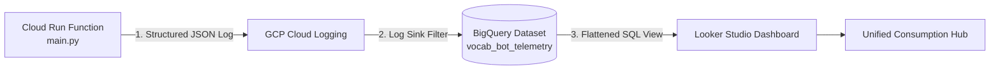

# Implementation Plan: Centralized Consumption Monitoring (BigQuery + Looker Studio)

## Overview
Implement a zero-cost, enterprise-grade consumption telemetry system for the Polish Vocab Bot across OpenAI, ElevenLabs, Telegram, and Google Cloud Run Functions using structured logging, Cloud Logging Log Router, Google BigQuery, and Looker Studio.



---

## 1. Scope & Components

### 1. Application Telemetry (`src/main.py`)
- Instrument [`send_vocab_task`](file:///d:/GK/Proj/poland-words-assist/src/main.py#L48-L218) to record:
  - **OpenAI**: Input tokens, output tokens, total tokens, and computed cost ($USD).
  - **ElevenLabs**: Characters synthesized in this run, audio byte payload size, fallback count, and live account-level quota status (`character_count` vs `character_limit` from `/v1/user/subscription`).
  - **Telegram**: Delivery count (`sendVoice` vs `sendMessage`), audio bytes dispatched, status.
  - **GCP Runtime**: Execution duration (`time.perf_counter()`), memory allocation.
- Log a clean JSON payload with `telemetry_type = "service_consumption"`.

### 2. Infrastructure as Code (`terraform/`)
- Enable `bigquery.googleapis.com` and `logging.googleapis.com` APIs.
- Create BigQuery Dataset: `vocab_bot_telemetry`.
- Create Google Logging Project Sink: `consumption_telemetry_sink` routing `jsonPayload.telemetry_type="service_consumption"` to BigQuery with partitioned tables enabled.
- Grant `roles/bigquery.dataEditor` to the Log Sink writer service account.
- Add BigQuery SQL View `v_consumption_metrics` to flatten and type the JSON columns for instant Looker Studio reporting.
- Export relevant outputs in `terraform/outputs.tf`.

### 3. Unit Tests (`tests/test_vocab.py`)
- Validate that the structured telemetry log is correctly generated.
- Ensure all existing unit tests pass without breakage.

### 4. Looker Studio Guide & Dashboard Setup
- Provide step-by-step guidance to connect Looker Studio to the BigQuery View.
- Provide chart layout templates:
  - **Scorecards**: Total Monthly Spend ($), ElevenLabs Quota Remaining (%), Tokens This Month, Invocations Count.
  - **Time Series**: Daily ElevenLabs character usage vs 1,000 char threshold.
  - **Time Series**: Daily OpenAI token consumption & estimated cost.
  - **Table**: Recent execution runs with full audit drill-down.

---

## 5. Troubleshooting & Operational Deployment Notes

### 1. IAM Permissions for Log Sinks
- **Error**: `googleapi: Error 403: Permission 'logging.sinks.create' denied`.
- **Cause**: Creating project-level Log Router sinks (`google_logging_project_sink`) is not permitted under standard `roles/editor`.
- **Solution**: Grant the Terraform deployment identity (e.g., CI/CD service account or deployer):
  - `roles/logging.configWriter` (or `roles/logging.admin`)
  - `roles/bigquery.admin` (to manage dataset access and IAM member binding for the sink writer)

### 2. BigQuery Table Lazy Creation
- **Behavior**: The BigQuery dataset `vocab_bot_telemetry` will appear empty immediately after deployment.
- **Cause**: Cloud Logging creates destination tables (e.g., `run_googleapis_com_stdout`) **lazily** upon receiving the *first* matching log entry.
- **Solution**: Do not attempt to create the BigQuery view before the table exists. Trigger the Cloud Run function once first, wait ~1–2 minutes for table creation, and only then run [`scripts/create_telemetry_view.sql`](file:///d:/GK/Proj/poland-words-assist/scripts/create_telemetry_view.sql).

### 3. Structured JSON Logging Format in Cloud Run
- **Requirement**: Cloud Run populates `jsonPayload` only when a log entry is a single line of valid JSON printed directly to `stdout`.
- **Gotcha**: Standard Python `logger.info()` writes to `stderr` with a formatted text prefix (e.g., `INFO:main:{"telemetry_type": ...}`). Cloud Run interprets this as `textPayload`, causing sink filters based on `jsonPayload.telemetry_type` to never match.
- **Fix**: Use `print(json.dumps(payload), flush=True)` in [`src/main.py`](file:///d:/GK/Proj/poland-words-assist/src/main.py#L93-L98) to ensure the payload is parsed as structured JSON.

### 4. End-to-End Activation Sequence
1. Deploy Terraform: `cd terraform && terraform apply`.
2. Trigger function once:
   ```bash
   gcloud scheduler jobs run polish-vocab-3h-cron --location=europe-west1
   ```
   *(or click "Force run" on the job in the GCP Console).*
3. Verify in BigQuery Console that table `run_googleapis_com_stdout` appeared.
4. Execute [`scripts/create_telemetry_view.sql`](file:///d:/GK/Proj/poland-words-assist/scripts/create_telemetry_view.sql) in BigQuery Console to build the `v_consumption_metrics` view.
5. Connect Looker Studio to `v_consumption_metrics`.
