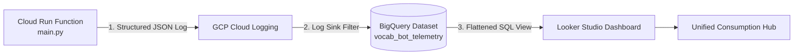

# Implementation Plan: Centralized Consumption Monitoring (BigQuery + Looker Studio)

## Overview
Implement a zero-cost, enterprise-grade consumption telemetry system for the Polish Vocab Bot across OpenAI, ElevenLabs, Telegram, and Google Cloud Run Functions using structured logging, Cloud Logging Log Router, Google BigQuery, and Looker Studio.

---

## 1. Scope & Components

### 1. Application Telemetry (`src/main.py`)
- Instrument [`send_vocab_task`](file:///d:/GK/Proj/poland-words-assist/src/main.py#L48-L218) to record:
  - **OpenAI**: Input tokens, output tokens, total tokens, and computed cost ($USD).
  - **ElevenLabs**: Characters synthesized in this run, audio byte payload size, fallback count, and live account-level quota status (`character_count` vs `character_limit` from `/v1/user/subscription`).
  - **Telegram**: Delivery count (`sendVoice` vs `sendMessage`), audio bytes dispatched, status.
  - **GCP Runtime**: Execution duration (`time.perf_counter()`), memory allocation.
- Log a clean JSON payload with `telemetry_type = "service_consumption"`.

### 2. Infrastructure as Code (`terraform/`)
- Enable `bigquery.googleapis.com` and `logging.googleapis.com` APIs.
- Create BigQuery Dataset: `vocab_bot_telemetry`.
- Create Google Logging Project Sink: `consumption_telemetry_sink` routing `jsonPayload.telemetry_type="service_consumption"` to BigQuery with partitioned tables enabled.
- Grant `roles/bigquery.dataEditor` to the Log Sink writer service account.
- Add BigQuery SQL View `v_consumption_metrics` to flatten and type the JSON columns for instant Looker Studio reporting.
- Export relevant outputs in `terraform/outputs.tf`.

### 3. Unit Tests (`tests/test_vocab.py`)
- Validate that the structured telemetry log is correctly generated.
- Ensure all existing unit tests pass without breakage.

### 4. Looker Studio Guide & Dashboard Setup
- Provide step-by-step guidance to connect Looker Studio to the BigQuery View.
- Provide chart layout templates:
  - **Scorecards**: Total Monthly Spend ($), ElevenLabs Quota Remaining (%), Tokens This Month, Invocations Count.
  - **Time Series**: Daily ElevenLabs character usage vs 1,000 char threshold.
  - **Time Series**: Daily OpenAI token consumption & estimated cost.
  - **Table**: Recent execution runs with full audit drill-down.
